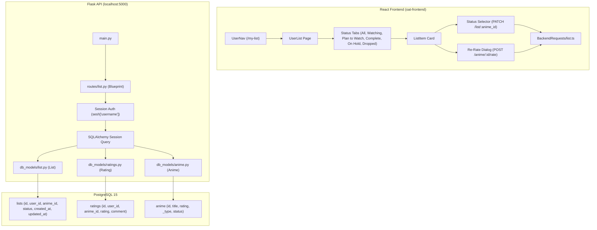

# Design Document: List Management & Status Tabs

## Overview
This design document details the architecture, data models, API endpoints, and React frontend components for the List Management feature in Open Anime Tracker. The feature introduces a PostgreSQL enum for list statuses (`plan_to_watch`, `watching`, `complete`, `dropped`, `on_hold`), updates the `List` database model with timestamps and uniqueness constraints, modernizes `routes/list.py` into a fully integrated Flask Blueprint, and provides a tabbed, interactive "My List" page on the frontend with status switching, sorting, and inline/modal re-rating.

## Steering Document Alignment

### Technical Standards (`tech.md`)
- **Backend:** Flask Blueprint registered in `main.py`, SQLAlchemy ORM mapped models inheriting from `db_models.base.Base`, Alembic migrations using PostgreSQL ENUM handling.
- **Frontend:** React 18 with TypeScript and Material-UI v5 components (`Tabs`, `Tab`, `Card`, `Select`, `MenuItem`, `Dialog`), consuming backend endpoints via the shared `axios` instance in `BackendRequests/base.ts`.
- **Authentication:** Validates active Redis session cookies via `flask.session['username']` and matches against the `users` table.

### Project Structure (`structure.md`)
- Enums in `enums/db_enums.py` and validated with helper functions.
- DB models in `db_models/list.py`.
- Migration script in `alembic/versions/`.
- Routes in `routes/list.py`.
- Frontend API helper in `oat-frontend/src/BackendRequests/list.ts`.
- Frontend types in `oat-frontend/src/Models/list.ts`.
- Page component in `oat-frontend/src/Pages/UserList.tsx`.
- Navigation in `oat-frontend/src/Header/user-nav.tsx`.
- Route registration in `oat-frontend/src/App.tsx`.

## Code Reuse Analysis

### Existing Components to Leverage
- **`enums/db_enums.py`**: Add `ListStatus` alongside `AnimeType`, `ReviewStatus`, `SeasonType`.
- **`db_models/ratings.py` & `common_funcs/ratings.py`**: Leverage `Rating` model and `submit_user_rating()` for fetching and updating user ratings.
- **`db_models/anime.py`**: Join anime titles, cover descriptions, types, and community ratings directly into list query responses.
- **`oat-frontend/src/BackendRequests/base.ts`**: Shared Axios instance configured with `withCredentials: true`.
- **`oat-frontend/src/BackendRequests/anime.ts`**: Reuse `animeRate()` for submitting updated scores.
- **`oat-frontend/src/context/auth_context.tsx`**: Protect `/my-list` with `AuthRoute` and display logged-in username.
- **`oat-frontend/src/Components/MechanicalRatingScroller/MechanicalPinLocRating.tsx`**: Reuse compact or dialog pin-loc rating scroller for tactile re-rating, or an accessible quick score modal.

## Architecture



## Data Models

### 1. `ListStatus` Enum (`enums/db_enums.py`)
```python
class ListStatus(enum.Enum):
  plan_to_watch = 'plan_to_watch'
  watching = 'watching'
  complete = 'complete'
  dropped = 'dropped'
  on_hold = 'on_hold'
```

### 2. `List` SQLAlchemy Model (`db_models/list.py`)
```python
from datetime import UTC, datetime
from sqlalchemy import Column, DateTime, Enum, ForeignKey, Integer, UniqueConstraint
from db_models.base import Base
from enums.db_enums import ListStatus

class List(Base):
  __tablename__ = 'lists'
  __table_args__ = (
      UniqueConstraint('user_id', 'anime_id', name='uq_user_anime_list'),
  )

  id = Column(Integer, primary_key=True)
  anime_id = Column(Integer, ForeignKey('anime.id'), nullable=False)
  user_id = Column(Integer, ForeignKey('users.id'), nullable=False)
  status = Column(Enum(ListStatus), nullable=False, default=ListStatus.plan_to_watch)
  created_at = Column(DateTime(timezone=True), default=datetime.now(tz=UTC))
  updated_at = Column(
      DateTime(timezone=True),
      default=datetime.now(tz=UTC),
      onupdate=datetime.now(tz=UTC),
  )

  def __init__(self, anime_id: int, user_id: int, status: ListStatus = ListStatus.plan_to_watch, **kwargs):
    super().__init__()
    self.anime_id = anime_id
    self.user_id = user_id
    self.status = status.value if hasattr(status, 'value') else status
    for key, value in kwargs.items():
      self.__dict__[key] = value

  def make_json(self):
    return {
        'id': self.id,
        'anime_id': self.anime_id,
        'user_id': self.user_id,
        'status': self.status.value if hasattr(self.status, 'value') else self.status,
        'created_at': self.created_at.isoformat() if self.created_at else None,
        'updated_at': self.updated_at.isoformat() if self.updated_at else None,
    }
```

### 3. Alembic Migration
- PostgreSQL type: `liststatus` with values: `'plan_to_watch', 'watching', 'complete', 'dropped', 'on_hold'`.
- Columns added: `status` (Enum), `created_at` (TIMESTAMP WITH TIME ZONE), `updated_at` (TIMESTAMP WITH TIME ZONE).
- Unique Constraint: `uq_user_anime_list` on `('user_id', 'anime_id')`.

## Components and Interfaces

### Backend Endpoints (`routes/list.py`)

1. **`GET /list`**
   - **Query Params:** `status` (optional, e.g. `watching`), `sort` (optional, e.g. `rating_desc`, `title_asc`, `updated_desc`).
   - **Behavior:**
     - Resolves user from `sesh.get('username')`.
     - Queries `List` joined with `Anime` and outer joined with `Rating` (`Rating.user_id == user.id` and `Rating.season_id.is_(None)`).
     - Returns list of items containing:
       - `id`: list entry ID
       - `anime_id`: anime ID
       - `status`: list status string
       - `created_at`, `updated_at`: ISO timestamp strings
       - `anime`: `{ id, title, jp_title, desc, _type, rating, content_rating }`
       - `user_rating`: `{ id, rating, comment }` or `null`
   - **Status Codes:** 200 OK, 401 Unauthorized, 500 Internal Error.

2. **`POST /list`**
   - **Body:** `{ "anime_id": 12, "status": "watching" }` (`status` is optional, defaults to `plan_to_watch`).
   - **Behavior:** Upserts the user's list entry (if already present, updates status; otherwise creates).
   - **Status Codes:** 200 OK, 400 Bad Request (invalid status or missing anime_id), 401 Unauthorized, 404 Anime Not Found.

3. **`PATCH /list/<int:anime_id>`**
   - **Body:** `{ "status": "complete" }`
   - **Behavior:** Updates status for `anime_id` for current user.
   - **Status Codes:** 200 OK, 400 Bad Request, 401 Unauthorized, 404 Not Found in list.

4. **`DELETE /list/<int:anime_id>`**
   - **Behavior:** Deletes the record from `lists`.
   - **Status Codes:** 200 OK, 401 Unauthorized, 404 Not Found.

5. **`GET /list/anime/<int:anime_id>`**
   - **Behavior:** Returns `{ "in_list": true/false, "status": "watching", "id": 5 }`.
   - **Status Codes:** 200 OK, 401 Unauthorized.

### Frontend Components

1. **`oat-frontend/src/Models/list.ts`**
   - Types: `ListStatus`, `UserListItem`, `ListSummaryCounts`.

2. **`oat-frontend/src/BackendRequests/list.ts`**
   - API caller functions: `fetchUserList()`, `addOrUpdateAnimeInList()`, `updateAnimeStatusInList()`, `removeAnimeFromList()`, `fetchAnimeListStatus()`.

3. **`oat-frontend/src/Pages/UserList.tsx`**
   - Top Bar: Title "My List", total anime count, sorting selector dropdown (`qa-list_sort-select`).
   - Status Tabs:
     - "All", "Watching", "Plan to Watch", "Complete", "On Hold", "Dropped".
     - Badge/count for each tab.
   - Anime Cards Feed:
     - `qa-list_item-card`
     - Anime title linking to details (`qa-list_item_title-click`).
     - Content Rating & Anime Type badges.
     - Community Rating score (`qa-list_community_rating-data`).
     - User Rating display (`qa-list_user_rating-data`).
     - Quick "Re-rate" button (`qa-list_re_rate-click`) opening the rating dialogue.
     - Status selector dropdown (`qa-list_status-select`).
     - Remove from list button (`qa-list_remove-click`).
   - Re-Rate Modal Dialog (`qa-list_rating_dialog`):
     - Allows selecting a new rating score (1-10) and optional comment blurb.
     - Saves via `animeRate()`, updates the local list item's rating and community rating.
   - Empty State (`qa-list_empty-empty`):
     - Friendly illustration / message with link to `/get-anime`.

4. **Integration in `AnimeDetails.tsx`**:
   - Add status selector to the Anime Details header so users can add to list directly while viewing a show.

## Error Handling
- Invalid status passed to backend -> 400 Bad Request with message `Invalid list status: ...`.
- User not authenticated -> 401 Unauthorized.
- Anime not found -> 404 Not Found.
- Database errors -> 500 Internal Server Error with clean log message.
- Frontend displays friendly alert banners on error (`qa-list_error-error`).

## Testing Strategy
- **Backend Tests (`tests/test_list_management.py`)**:
  - Test list model creation with status and defaults.
  - Test uniqueness constraint enforcement.
  - Test `GET /list` returns joined anime and user rating.
  - Test `POST /list` adds new entry and updates existing entry (upsert).
  - Test `PATCH /list/<anime_id>` status changes.
  - Test `DELETE /list/<anime_id>` removal.
  - Test 401 on unauthenticated access.
  - Test 400 on invalid enum input.
- **Frontend QA Test IDs**:
  - All interactive elements tagged with `qa-` prefixes according to `frontend_testids.md`.
